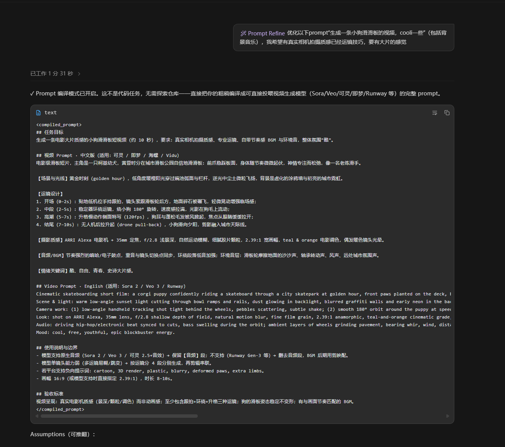

# prompt-refine

**把一句话想法，编译成新对话可直接执行的专业级 prompt。**

*A prompt compiler: turn one rough sentence into a self-contained, ready-to-run prompt for any AI coding agent.*

## 为什么你需要它

和 AI 结对干活的人，大概都经历过这些：

- 需求在脑子里就一句话——"给这个 API 加个限流"——刚说完，AI 就开始自由发挥，方向跑偏，来回拉扯十几个回合才回到正轨。
- 好不容易在对话里把项目背景、代码约定、边界条件喂齐了，上下文窗口也快满了；换个新对话接着做，一切从零开始。
- 你当然知道"把 prompt 写清楚"能避免这一切，但每次都手写一份完整、自包含的 prompt，比自己做还累。

**prompt-refine 的答案：prompt 不该手写，该编译。** 它拿到你的粗糙一句话，先只读探查你的项目（真实的文件路径、既有约定、测试命令、边界约束），再产出一份五段式、自包含、可在全新对话零上下文直接执行的编译稿。你复制、粘贴、开工。

## 工作原理

它是一个**提示词编译器**：交付编译稿本身就是任务，默认绝不执行（compile-then-execute）。

每一条任务描述都走这四步：

1. **扎根项目（Ground）** —— 用只读方式探查任务涉及的内容：仓库布局、README / AGENTS.md 类约定文档、任务点名或显然涉及的模块。只读相关的，不乱逛；提取具体锚点（文件路径、入口、既有约定、测试命令、约束边界），这些锚点直接写进编译稿。
2. **只澄清挡路的问题** —— 只有当缺失信息会把任务带偏方向时，才先问 1–2 个聚焦问题；否则立即编译，并在编译稿后附一个简短的 `Assumptions` 块，列出编译时采用的关键假设，你可以推翻。
3. **无条件编译** —— 每条描述都会得到编译稿，"任务已经很清楚"只会降低重构幅度，不会免编译。输出为五段式结构（跟随你的语言，代码与路径原样保留）：

   ```
   ## 任务目标       —— 做什么、为什么，一句话讲清动机
   ## 项目上下文     —— 关键文件路径与职责、相关模块、必须遵守的约定与边界
                         （自包含，新对话无需再探索）
   ## 要求与边界     —— 必须做的 / 明确不做的
   ## 执行步骤       —— 编号步骤，含验证方式
   ## 验收标准       —— 怎样算完成：测试命令、产物路径、检查点
   ```

4. **停下** —— 输出编译稿后停止，末尾一行说明：复制到新对话执行；要调整编译稿或就在本对话执行，直接说。

**两种模式：**

- **One-shot（默认）**：自然语言说"帮我优化/写一个提示词"，只编译本次描述，之后恢复正常对话——一次性请求不会捕获整个会话。
- **Persistent（显式开启）**：`/prompt-refine` 或 `/refine` 开启，此后每条任务描述都先编译；`/refine off` 退出。

**硬规则：**

- **默认不执行** —— 不创建文件、不运行业务命令；仅当你明确说"执行"时，才在当前对话运行该任务。
- **自包含是及格线** —— 编译稿必须能在全新对话里零上下文执行：它依赖的一切（路径、约定、约束、验证命令）都写在稿内。
- **忠实意图与语言** —— 重构、消歧、扎根项目，但绝不添加你没有要求的范围；中文任务产出中文 prompt。
- **小任务不灌水** —— 结构随任务规模伸缩，不会给两行的小事套企业级方案模板。

## 使用方法

本仓库就是技能本体，核心只有一个 `SKILL.md`。它兼容任何按 **SKILL.md 约定**（YAML frontmatter `name` / `description`）发现技能的 AI 编码代理，Claude Code 及各类支持 Agent Skills 的同类工具皆可。

安装：把 `SKILL.md` 放进你 agent 技能目录下的 `prompt-refine/` 子目录（用户级目录如 `~/.claude/skills/`，项目级如 `<repo>/.claude/skills/`，以你的 agent 文档为准）：

```bash
git clone https://github.com/Daft-GD/prompt-refine.git
mkdir -p ~/.claude/skills/prompt-refine
cp prompt-refine/SKILL.md ~/.claude/skills/prompt-refine/
```

使用：装好后直接在对话里触发——

- 一次性："帮我把这个任务描述优化成可执行的 prompt：给这个 API 加个限流"
- 持久模式：`/prompt-refine`，此后每条任务描述都会先编译再执行（说"执行"才执行）。

## 效果示例

**Before —— 你说的一句话：**

> 给这个 API 加个限流

**After —— 编译出的 prompt（骨架示意）：**

```markdown
## 任务目标
为现有 REST API 增加进程内限流，防止突发流量打垮单实例服务。

## 项目上下文（自包含，新对话无需再探索）
- 服务入口：src/server.js（Express 4，路由集中在 src/routes/）
- 中间件目录：src/middleware/（既有 auth、请求日志，风格为高阶函数工厂）
- 无 Redis，单实例部署，进程内计数即可满足
- 测试：npm test（mocha + supertest）

## 要求与边界
- 必须做：按 IP 限流的中间件，默认 60 次/分钟，阈值可配置
- 明确不做：不引入 Redis / 分布式限流，不改既有路由与响应结构

## 执行步骤
1. 新增 src/middleware/rateLimit.js，实现固定窗口计数中间件
2. 在 src/server.js 全局挂载，阈值读环境变量 RATE_LIMIT_PER_MIN（默认 60）
3. 在 test/middleware/rateLimit.test.js 补 429 与放行场景用例

## 验收标准
- npm test 全绿，含限流触发返回 429 的用例
- 手动验证：同一 IP 连续 70 次请求，第 61 次起收到 HTTP 429
```

若编译时做了假设，编译稿后还会附 `Assumptions` 块（例如"假设无需区分匿名与登录用户的限额"），供你确认或推翻。

### 一次真实运行

不只代码任务——任何要交给 AI 的活儿都能编译。下面是一次真实运行：输入一句"生成一条小狗滑滑板的视频"，编译出的 prompt 自带运镜设计、摄影质感、BGM 方向、中英双版与验收标准，复制给任意视频生成模型即可开跑：

<p align="center">
  
</p>

## License

[MIT](./LICENSE) © 2026 Li-Bailiang
